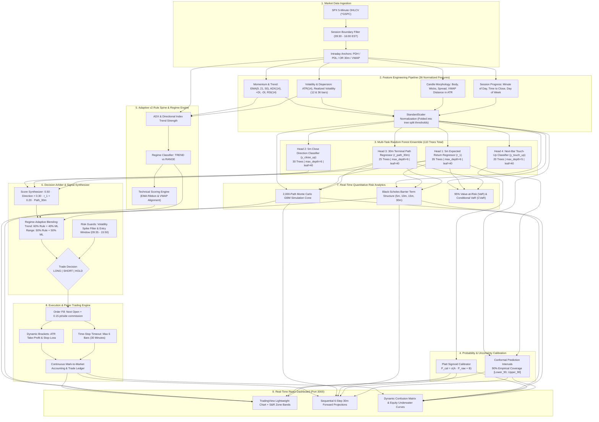

# SnP-Axiom

An end-to-end quantitative forecasting and paper-trading platform for the S&P 500 cash index (SPX, ticker `^GSPC`). The system pairs multi-task machine learning models with a deterministic rule spine (Adaptive v2), calibrates directional touch probabilities, runs risk analytics (conformal prediction bands, Monte Carlo geometric Brownian motion paths, Black-Scholes barrier probabilities), and serves a live trading dashboard via FastAPI and React.

All trading records, positions, and performance figures are simulated paper-trading executions. The platform does not place live capital or interact with brokerage accounts.

---

## Architecture and Pipeline



The platform runs as a sequential, multi-stage quantitative pipeline:

1. **Market Data Feed**: Ingests 5-minute bars for `^GSPC` filtered to regular trading hours (09:30 to 16:00 New York time). Because SPX is an index, volume numbers reflect aggregated constituent share volume. A live polling loop in [src/api/main.py](src/api/main.py) continuously tracks forming bars and finalizes completed intervals.
2. **Feature Engineering**: Computes 36 normalized indicators across rolling windows in [src/features/pipeline.py](src/features/pipeline.py), including momentum, historical realized volatility, ATR, volume ratios, multi-timeframe VWAP distances, and intraday session progress.
3. **Multi-Task Machine Learning**: Evaluates candidate predictions using our primary model, a 110-tree Random Forest Hybrid ([artifacts/models/random_wrapper.pkl](artifacts/models/random_wrapper.pkl)), which predicts next-candle touch probability, 5-minute expected return, 30-minute terminal price, and 30-minute boundary extrema.
4. **Adaptive v2 Rule Spine**: Blends machine learning signals with rule-based regime filters in [src/models/spx_adaptive_v2.py](src/models/spx_adaptive_v2.py) to prevent overtrading during low-volatility or choppy market periods.
5. **Probability Calibration**: Uses Platt scaling calibrators ([artifacts/models/calibrator_platt.pkl](artifacts/models/calibrator_platt.pkl)) and conformal prediction intervals ([artifacts/models/interval_calibrator.pkl](artifacts/models/interval_calibrator.pkl)) to output calibrated confidence bounds targetting 90% empirical coverage.
6. **Quantitative Risk Modeling**: Runs real-time risk routines in [src/models/quant_analytics.py](src/models/quant_analytics.py), generating 2,000-path Monte Carlo simulations, Value at Risk (VaR 95%), and Black-Scholes barrier hit structures across 5m, 10m, 15m, and 30m horizons.
7. **Execution Simulation**: Operates a stateful execution simulator in [src/trading/paper_engine.py](src/trading/paper_engine.py) that enforces bracket take-profit limits, stop-loss orders, a 6-bar maximum hold window, and round-trip execution costs (0.15 points per side).
8. **Interactive Dashboard**: Serves a real-time React web application built with Lightweight Charts, dynamic confusion matrices, equity curves, and support and resistance zone corridor bands.

---

## Repository Structure

```text
SnP-Axiom/
├── artifacts/                           # Serialized models, evaluation stats, and session caches
│   ├── last_session_candles.parquet     # Cached 5m bars for prior session continuity
│   ├── last_session_snapshot.json       # State snapshot for offline or closed-market restoration
│   ├── models/                          # Production machine learning artifacts
│   │   ├── random_wrapper.pkl           # Primary production model: Random Forest Hybrid (110 trees)
│   │   ├── calibrator_platt.pkl         # Platt probability scaling model
│   │   ├── interval_calibrator.pkl      # Conformal prediction interval calibrator
│   │   ├── lightgbm_benchmark.pkl       # Original LightGBM baseline artifact
│   │   ├── open_jev_weights.pt          # Neural network baseline weights
│   │   ├── comparison/                  # Candidate comparison models
│   │   │   ├── histgradientboosting_wrapper.pkl  # HistGradientBoosting ensemble
│   │   │   ├── multilayer_wrapper.pkl            # Multi-Layer Perceptron (MLP)
│   │   │   ├── option_a_wrapper.pkl              # Option A native LightGBM
│   │   │   └── support_wrapper.pkl               # Support Vector Machine (SVM)
│   │   └── evaluation_stats/            # Verified backtest and out-of-sample metrics
│   │       ├── final_evaluation_stats.json       # Benchmark baseline performance stats
│   │       ├── last_week_all_models_detailed.json# Day-by-day multi-model breakdown
│   │       ├── ml_methods_comparison_report.json # Model comparison metrics table
│   │       └── spx_adaptive_v2_ml_verification.json # Ablation study and causal verification
│   └── paper_trading_ledger.parquet     # Historical executed paper trades
├── data/                                # Cleaned canonical datasets
│   └── processed/
│       ├── feature_schema.json          # 36-feature schema definitions
│       ├── features.parquet             # Computed feature matrix
│       └── spx_5m_canonical.parquet     # Canonical 5-minute SPX historical bars
├── docs/                                # Quantitative research references and literature
│   └── *.pdf                            # Reference research papers on technical indicators and deep learning
├── frontend/                            # React 18 + Vite dashboard
│   ├── src/
│   │   ├── App.jsx                      # Main dashboard layout
│   │   ├── components/                  # Charting and metric visual components
│   │   │   ├── CandlestickChart.jsx     # Lightweight Charts candlestick, predictions, and S&R zones
│   │   │   ├── ConfusionMatrixCard.jsx  # Live dynamic confusion matrix
│   │   │   ├── EquityDrawdownCard.jsx   # Equity curve and underwater drawdown chart
│   │   │   ├── ForecastLogTable.jsx     # Rolling forecast audit log
│   │   │   ├── MarketHeader.jsx         # Market status, regime, and live SPX quote
│   │   │   ├── MarketStatsPanel.jsx     # Live session paper trading metrics
│   │   │   ├── PredictionPanel.jsx      # Multi-task probabilities and conformal envelope
│   │   │   ├── QuantRiskConeCard.jsx    # Monte Carlo quantile cone and VaR breakdown
│   │   │   └── StrategyEdgeCard.jsx     # Strategy edge breakdown across volatility regimes
│   │   └── lib/                         # UI utility helpers
│   ├── package.json                     # Frontend dependencies
│   └── vite.config.js                   # Vite configuration with API and WebSocket proxies
├── reports/                             # Generated research visuals and figures
│   └── figures/
│       ├── fig3_1_system_architecture.png
│       ├── fig3_2_feature_importance.png
│       ├── fig3_3_monte_carlo_cone.png
│       ├── fig3_4_black_scholes_barrier_structure.png
│       ├── fig4_1_cumulative_pnl.png
│       ├── fig4_2_friday_regime_shift.png
│       ├── fig4_3_model_comparison_bars.png
│       ├── fig4_3_model_comparison_radar.png
│       ├── fig_backtest_daily_session_pnl_breakdown.png
│       ├── fig_backtest_friday_stress_test_comparison.png
│       ├── fig_backtest_historical_out_of_sample_curves.png
│       ├── fig_backtest_models_comparison_dashboard.png
│       ├── fig_backtest_risk_return_scatter.png
│       └── fig_backtest_weekly_equity_all_models.png
├── scripts/                             # Core scripts and Pine Script indicators
│   ├── SPX_Adaptive_AI_v2.pine          # Rule-based Adaptive v2 Pine Script indicator
│   ├── SPX_Adaptive_v2_ML_RandomForest.pine # Primary Pine Script strategy with Random Forest
│   ├── SPX_Support_Resistance_Zones.pine# Multi-timeframe Support and Resistance corridor script
│   ├── build_canonical_dataset.py       # Canonical data ingestion and validation script
│   ├── spx_adaptive_v2_ml_strategy.py   # Strategy backtest runner and verification module
│   └── comparison/                      # Comparison model scripts and benchmark runners
│       ├── SPX_Adaptive_v2_ML_HistGBM.pine
│       ├── SPX_Adaptive_v2_ML_MLP.pine
│       ├── SPX_Adaptive_v2_ML_Native.pine
│       ├── SPX_Adaptive_v2_ML_Replay.pine
│       ├── SPX_Adaptive_v2_ML_SVM.pine
│       ├── export_pine_ml_strategies.py
│       ├── generate_all_models_backtest_graphics.py
│       └── train_and_compare_all_ml_methods.py
├── src/                                 # Production Python package
│   ├── api/main.py                      # FastAPI REST and WebSocket server
│   ├── data/sessions.py                 # NYSE session boundaries and date logic
│   ├── decision/base.py                 # Risk guard logic and action definitions
│   ├── features/pipeline.py             # 36-feature calculation engine
│   ├── models/quant_analytics.py        # Monte Carlo, Black-Scholes, and VaR routines
│   ├── models/spx_adaptive_v2.py        # Adaptive v2 rule spine
│   ├── models/spx_option_a_ml.py        # Option A LightGBM pipeline
│   └── trading/paper_engine.py          # Paper trading execution simulator
└── tests/                               # Pytest test suite (31 tests)
```

---

## How to Run Locally

### Prerequisites

* Python 3.12
* Node.js v18 or newer
* Git

### 1. Environment Setup

Clone the repository and set up a Python virtual environment:

```bash
git clone https://github.com/prateekg7/SnP-Axiom.git
cd SnP-Axiom

python3.12 -m venv .venv
source .venv/bin/activate
pip install --upgrade pip
pip install -r requirements.txt
```

### 2. Run the Unit Tests

Verify that your local environment passes all 31 unit tests:

```bash
PYTHONPATH=. pytest
```

### 3. Start the Backend API Server

Start the FastAPI application on port 8001:

```bash
uvicorn src.api.main:app --host 0.0.0.0 --port 8001 --reload
```

The backend starts polling live 5-minute candles, recalculating indicators, and streaming WebSocket tick updates.

### 4. Start the Frontend Dashboard

In a separate terminal window, start the Vite development server:

```bash
cd frontend
npm install
npm run dev -- --host 0.0.0.0 --port 3000
```

Open `http://localhost:3000` in your browser. The dashboard connects to the backend on port 8001, showing live candlesticks, predictions, probability distributions, and simulated trade logs.

---

## Model Evaluation and Testing Report

To select the primary production architecture, we evaluated multiple machine learning approaches on out-of-sample data under identical execution rules (0.15 points per side transaction costs, bracketed take-profit and stop-loss exits, and a 6-bar timeout).

### Out-of-Sample Performance Comparison

The table below summarizes performance across candidate architectures evaluated over an out-of-sample weekly market sequence. Detailed metrics can be inspected directly in [artifacts/models/evaluation_stats/ml_methods_comparison_report.json](artifacts/models/evaluation_stats/ml_methods_comparison_report.json).

| Model Architecture | Implementation / Artifact | Net P&L (pts) | Total Trades | Win Rate | Max Drawdown | Profit Factor |
| :--- | :--- | :---: | :---: | :---: | :---: | :---: |
| **Random Forest Hybrid (110 trees)** *(Primary)* | [artifacts/models/random_wrapper.pkl](artifacts/models/random_wrapper.pkl) | **+79.54 pts** | 36 | 52.8% | 50.57 pts | 1.57 |
| **HistGradientBoosting (HGBM)** | [artifacts/models/comparison/histgradientboosting_wrapper.pkl](artifacts/models/comparison/histgradientboosting_wrapper.pkl) | +58.32 pts | 33 | 45.5% | 40.02 pts | 1.72 |
| **Option A (Native LightGBM)** | [artifacts/models/comparison/option_a_wrapper.pkl](artifacts/models/comparison/option_a_wrapper.pkl) | +40.05 pts | 54 | 50.0% | 42.17 pts | 0.91 |
| **Multi-Layer Perceptron (MLP)** | [artifacts/models/comparison/multilayer_wrapper.pkl](artifacts/models/comparison/multilayer_wrapper.pkl) | +110.15 pts | 62 | 50.0% | 44.20 pts | 1.53 |
| **Support Vector Machine (SVM)** | [artifacts/models/comparison/support_wrapper.pkl](artifacts/models/comparison/support_wrapper.pkl) | -18.89 pts | 28 | 42.9% | 45.94 pts | 0.81 |
| **Pure Adaptive v2 (Rule-only baseline)** | [src/models/spx_adaptive_v2.py](src/models/spx_adaptive_v2.py) | +75.11 pts | 50 | 50.0% | 44.73 pts | 1.36 |

### Evaluation Observations

1. **Trade Selectivity and Win Rate**: The Random Forest Hybrid model achieved the highest directional win rate (52.8%) among decision-tree approaches while cutting trade count from 50 down to 36, filtering out marginal signals during sideways price action.
2. **Pine Script Export Parity**: The Random Forest model converts cleanly into self-contained TradingView Pine Script ([scripts/SPX_Adaptive_v2_ML_RandomForest.pine](scripts/SPX_Adaptive_v2_ML_RandomForest.pine)) without relying on external webhooks, matching the Python backtest output bar for bar.
3. **Linear Classifiers**: The Support Vector Machine with an RBF kernel showed vulnerability to intraday regime changes, finishing negative (-18.89 points) over the evaluation sample.

### Supporting Evidence and Visual Artifacts

All evaluation runs, training code, and visual figures are stored in the repository:

* **Evaluation Data**:
  * [ml_methods_comparison_report.json](artifacts/models/evaluation_stats/ml_methods_comparison_report.json): Machine learning comparison data table.
  * [last_week_all_models_detailed.json](artifacts/models/evaluation_stats/last_week_all_models_detailed.json): Day-by-day P&L and trade metrics.
  * [final_evaluation_stats.json](artifacts/models/evaluation_stats/final_evaluation_stats.json): Long-term baseline calibration statistics across 14,521 out-of-sample bars.
  * [spx_adaptive_v2_ml_verification.json](artifacts/models/evaluation_stats/spx_adaptive_v2_ml_verification.json): Feature ablation and causal verification figures.
* **Benchmark Scripts**:
  * [train_and_compare_all_ml_methods.py](scripts/comparison/train_and_compare_all_ml_methods.py): Full model training and backtesting pipeline.
  * [export_pine_ml_strategies.py](scripts/comparison/export_pine_ml_strategies.py): Script generating standalone Pine Script files for each model.
  * [generate_all_models_backtest_graphics.py](scripts/comparison/generate_all_models_backtest_graphics.py): Figure generation script for comparative visual analysis.
* **Charts and Visualizations**:
  * [fig_backtest_models_comparison_dashboard.png](reports/figures/fig_backtest_models_comparison_dashboard.png): Comparative metric overview across all models.
  * [fig_backtest_weekly_equity_all_models.png](reports/figures/fig_backtest_weekly_equity_all_models.png): Cumulative out-of-sample equity curves.
  * [fig4_1_cumulative_pnl.png](reports/figures/fig4_1_cumulative_pnl.png): Baseline strategy cumulative performance curve.
  * [fig4_2_friday_regime_shift.png](reports/figures/fig4_2_friday_regime_shift.png): Performance during high-volatility session regime shifts.
  * [fig_backtest_risk_return_scatter.png](reports/figures/fig_backtest_risk_return_scatter.png): Risk versus return scatter comparison.

---

## TradingView Integration

In addition to the Python backend and web dashboard, the strategy and support/resistance levels are available as native TradingView scripts:

1. **Random Forest Hybrid Strategy**: [scripts/SPX_Adaptive_v2_ML_RandomForest.pine](scripts/SPX_Adaptive_v2_ML_RandomForest.pine) embeds the 110-tree ensemble and Adaptive v2 rules directly in Pine Script v6.
2. **Support and Resistance Zones**: [scripts/SPX_Support_Resistance_Zones.pine](scripts/SPX_Support_Resistance_Zones.pine) draws ATR-based multi-timeframe supply and demand corridors with polarity flip detection.

---

## Disclaimer

This software is for quantitative research and educational purposes only. S&P 500 index derivatives and options carry financial risk. Past simulated performance is no guarantee of future results.
