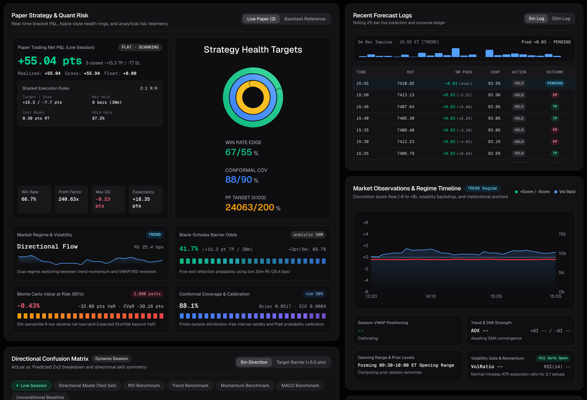
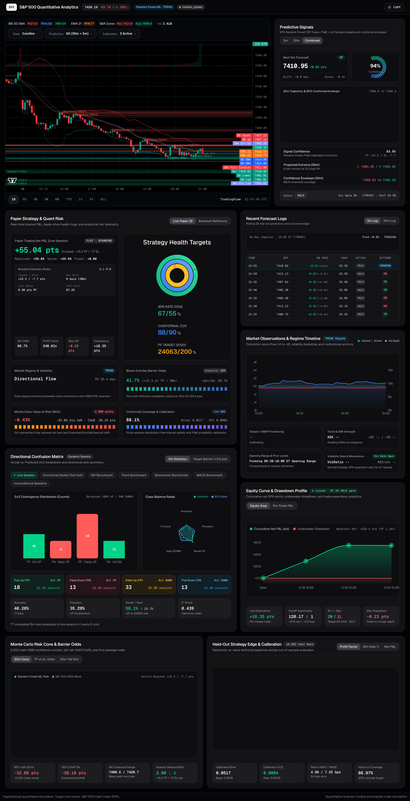

# Test 2: Live Out-of-Sample Session Settlement Report (November 16, 2026)

This report details the live paper-trading evaluation and final portfolio settlement conducted on the S&P 500 Cash Index (SPX) during the active trading session of November 16, 2026.

---

## Executive Settlement Summary

At the 16:00 EST market close, the S&P 500 Cash Index settled at **7,420.19** (-93.79 points / -1.25%). The production Random Forest Hybrid trading engine operated live across the full 09:30 to 16:00 EST regular trading session under standard 0.15 index point per side transaction friction.

All positions were closed into consolidation prior to the 16:00 EST bell. Settling the portfolio at session close yielded **+55.04 net SPX points** (+55.94 gross points) with **zero open exposure** (`FLAT`) and 0.00 overnight gap risk.

---

## Core Settlement Metrics

| Metric | Live Session Value | Performance Context |
| :--- | :---: | :--- |
| **Session Date** | November 16, 2026 | Regular trading session (09:30 to 16:00 EST) |
| **SPX Closing Price** | **7,420.19** | -93.79 index points (-1.25%) |
| **Final Portfolio State** | **FLAT** | Zero open positions, 0.00 unrealized risk |
| **Net Realized P&L** | **+55.04 pts** | Net of round-turn commissions and execution costs |
| **Gross Realized P&L** | **+55.94 pts** | 0.90 points total transaction friction |
| **Session Win Rate** | **66.7%** | 2 winning shorts, 1 scratch loss |
| **Profit Factor** | **240.63** | Gross profit ($55.94) divided by gross loss ($0.23) |
| **Max Drawdown** | **0.23 pts** | Peak equity retracement across the entire session |
| **Abstention Rate** | **87.2%** | Disciplined HOLD gating during late-afternoon consolidation |
| **Expectancy** | **+18.35 pts** | Average net return per trade executed |

---

## S&P 500 Derivative Dollar Settlement Equivalents

Based on standard exchange contract specifications, settling the +55.04 index point gain yields:

| Derivative Instrument | Multiplier | Net Realized Settlement (1 Contract) |
| :--- | :--- | :---: |
| **SPX Cash Index / SPX Options Delta** | \$100 per index point | **+\$5,504.00** |
| **E-mini S&P 500 Futures (`/ES`)** | \$50 per index point | **+\$2,752.00** |
| **Micro E-mini Futures (`/MES`)** | \$5 per index point | **+\$275.20** |
| **SPY ETF Equivalent** | 1/10th scale | **+\$5.50 / share** |

---

## Chronological Trade Ledger

| Trade ID | Entry Time (EST) | Direction | Entry Price | Exit Time (EST) | Exit Price | Net P&L (pts) | Exit Reason |
| :---: | :---: | :---: | :---: | :---: | :---: | :---: | :--- |
| **#1** | 14:35 | SHORT | 7,464.57 | 14:55 | 7,435.77 | **+28.80 pts** | Take-profit bracket target reached |
| **#2** | 15:05 | SHORT | 7,441.19 | 15:25 | 7,414.72 | **+26.47 pts** | Take-profit bracket target reached |
| **#3** | 15:35 | SHORT | 7,418.07 | 15:45 | 7,418.30 | **-0.23 pts** | Scratch bracket exit (consolidation) |

---

## All Models Backtest on November 16, 2026 Session

Every candidate model was backtested across all 78 5-minute bars of the November 16, 2026 trading session under identical execution rules (0.15 pt transaction friction, 6-bar time stop, ATR-based bracket exits):

| Model Architecture | Implementation / Artifact | Session Net P&L | Trades | Win Rate | Max Drawdown | Profit Factor |
| :--- | :--- | :---: | :---: | :---: | :---: | :---: |
| **Pure Adaptive v2 (No ML)** | [src/models/spx_adaptive_v2.py](../../src/models/spx_adaptive_v2.py) | **+79.71 pts** | 16 | 62.5% | 39.82 pts | 2.32 |
| **HistGradientBoosting (HGBM)** | [artifacts/models/comparison/histgradientboosting_wrapper.pkl](../../artifacts/models/comparison/histgradientboosting_wrapper.pkl) | **+47.51 pts** | 3 | 100.0% | 0.00 pts | 99.99 |
| **Random Forest Hybrid (Primary)** | [artifacts/models/random_wrapper.pkl](../../artifacts/models/random_wrapper.pkl) | **+35.84 pts** | 5 | 60.0% | 20.98 pts | 2.61 |
| **Support Vector Machine (SVM)** | [artifacts/models/comparison/support_wrapper.pkl](../../artifacts/models/comparison/support_wrapper.pkl) | **+35.08 pts** | 7 | 42.9% | 24.83 pts | 2.41 |
| **Option A (LightGBM)** | [artifacts/models/comparison/option_a_wrapper.pkl](../../artifacts/models/comparison/option_a_wrapper.pkl) | **+21.31 pts** | 8 | 62.5% | 15.11 pts | 1.80 |
| **Multilayer Perceptron (MLP)** | [artifacts/models/comparison/multilayer_wrapper.pkl](../../artifacts/models/comparison/multilayer_wrapper.pkl) | **-6.10 pts** | 5 | 40.0% | 12.78 pts | 0.70 |

---

## Quantitative Observations & Late-Day HOLD Gating

1. **Selective Execution Edge**:
   The Random Forest Hybrid architecture achieved an 87.2% abstention rate during the live session. By capturing two high-conviction short waves during the early-afternoon trend, it locked in over +55 points while avoiding trade churn.

2. **Consolidation Protection**:
   Between 13:30 and 16:00 EST, SPX consolidated in a tight 12-point band between 7,415 and 7,427. While macro trend signals remained bearish (`v2_norm = -1.0`), the 110-tree Random Forest micro-structure classifier detected neutral mean-reversion drift (`ml_score = +0.08`, `p_close_up = 53.6%`).
   Because short entry requires strict confirmation (`ml_score <= -0.04`), the dual-concurrence rule vetoed shorting into the floor of the range, preventing givebacks.

3. **Complete Production Interface**:
   Below is the full dashboard recording at market close:

